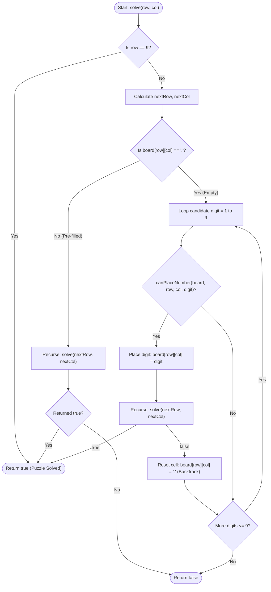

# Sudoku Solver (Java)

**A Modular, Object-Oriented Sudoku Solving Application Using Recursive Backtracking**

---

## Table of Contents
1. [Project Overview](#project-overview)
2. [Problem Statement & Objectives](#problem-statement--objectives)
3. [Sudoku Rules](#sudoku-rules)
4. [Backtracking Algorithm](#backtracking-algorithm)
5. [Technologies & Tools Used](#technologies--tools-used)
6. [Repository Structure](#repository-structure)
7. [Source File Descriptions](#source-file-descriptions)
8. [Sample Input & Expected Output](#sample-input--expected-output)
9. [Compilation & Execution Guide](#compilation--execution-guide)
10. [Key Features & Learning Outcomes](#key-features--learning-outcomes)
11. [Group Information](#group-information)
12. [License](#license)

---

## Project Overview

The **Sudoku Solver** is a console-based Java application developed to solve classic 9×9 Sudoku puzzles algorithmically. Built according to Object-Oriented Programming (OOP) principles, the project decomposes puzzle representation, validation constraints, and recursive backtracking into clean, dedicated classes. 

This project was developed as an academic practical assignment demonstrating recursion, search space pruning via constraint propagation, and modular software engineering in Java.

---

## Problem Statement & Objectives

### Problem Statement
Sudoku is a well-known NP-complete constraint satisfaction problem. Given a partially filled 9×9 grid containing initial numerical clues (values `1` through `9`) and empty cells (represented by `'.'`), the objective is to determine a complete assignment of values to all vacant cells such that all standard Sudoku constraints are strictly satisfied.

### Objectives
- Design and implement a robust, object-oriented software architecture in standard Java.
- Implement an efficient recursive backtracking algorithm with step-by-step constraint validation.
- Enforce clean separation of concerns among board representation, rule validation, and solver execution.
- Provide comprehensive test documentation and benchmark examples for verification.

---

## Sudoku Rules

A valid 9×9 Sudoku grid must fulfill three fundamental invariants simultaneously:

| Rule | Scope | Description |
| :--- | :--- | :--- |
| **Row Constraint** | Horizontal Line | Every row must contain all digits from **1 to 9** exactly once without duplicates. |
| **Column Constraint** | Vertical Line | Every column must contain all digits from **1 to 9** exactly once without duplicates. |
| **Box Constraint** | 3×3 Subgrid | Each of the nine non-overlapping **3×3 subgrids** must contain all digits from **1 to 9** without duplicates. |

---

## Backtracking Algorithm

The solver utilizes **Recursive Backtracking**, a depth-first search technique that systematically constructs candidate solutions and abandons (backtracks from) candidates as soon as they violate any Sudoku rule.



### Step-by-Step Execution Flow

1. **Base Case Check**:
   The recursive solver method `solve(char[][] board, int row, int col)` checks if `row == 9`. If true, the entire grid has been traversed without constraint violations, and the method returns `true`.
2. **Coordinate Progression**:
   The next cell coordinates are determined:
   - If `col == 8`, wrap to `nextRow = row + 1` and `nextCol = 0`.
   - Otherwise, advance along the row: `nextRow = row` and `nextCol = col + 1`.
3. **Clue Skipping**:
   If the current cell already contains an initial clue (`board[row][col] != '.'`), the solver skips it by directly recursing to `solve(board, nextRow, nextCol)`.
4. **Candidate Exploration**:
   For an empty cell (`'.'`), the solver evaluates candidates `1` through `9`:
   - `SudokuValidator.canPlaceNumber(board, row, col, number)` verifies whether the candidate digit violates row, column, or 3×3 subgrid constraints.
   - If valid, the digit is assigned: `board[row][col] = (char)(number + '0')`.
   - The solver recursively calls `solve(board, nextRow, nextCol)` to attempt to complete the rest of the puzzle.
   - If the recursive call returns `true`, the assignment is preserved and `true` propagates up the call stack.
5. **Backtracking Step**:
   If no downstream path yields a solution with that candidate, the solver unassigns the cell: `board[row][col] = '.'` and attempts the next candidate digit.
6. **Failure Termination**:
   If all digits from `1` to `9` fail to satisfy the board constraints, the method returns `false`, prompting backtracking in the preceding caller frame.

---

## Technologies & Tools Used

- **Programming Language**: Java (JDK 8 or higher)
- **Compiler / Runtime**: `javac` and `java` (Standard Edition Development Kit)
- **Paradigm**: Object-Oriented Programming (OOP)
- **Version Control**: Git & GitHub
- **Operating System**: Platform-independent (Windows / Linux / macOS)

---

## Repository Structure

```text
sudoku_solver/
├── examples/
│   ├── expected-output.txt    # Solved 9x9 reference grid with verification documentation
│   └── sample-input.txt       # Unsolved 9x9 sample puzzle with problem specifications
├── src/
│   ├── Main.java              # Entry point coordinating board display and solver execution
│   ├── SudokuBoard.java       # Grid data structure and formatted console rendering
│   ├── SudokuSolver.java      # Recursive backtracking search engine
│   └── SudokuValidator.java   # Row, column, and 3x3 subgrid rule checker
├── LICENSE                    # Repository license
└── README.md                  # Project overview and academic documentation
```

---

## Source File Descriptions

All source files are located in the `src/` directory:

| Class / File | Primary Responsibility | Key Methods |
| :--- | :--- | :--- |
| [`Main.java`](file:///c:/Users/user/Documents/sudoku_solver/src/Main.java) | Application entry point. Instantiates `SudokuBoard` and `SudokuSolver`, triggers the solve operation, and displays formatted status outputs. | `main(String[] args)` |
| [`SudokuBoard.java`](file:///c:/Users/user/Documents/sudoku_solver/src/SudokuBoard.java) | Maintains internal 2D board state (`char[][]`) initialized with a standard puzzle. Provides structured console rendering with row and box separators. | `getBoard()`, `displayBoard()` |
| [`SudokuSolver.java`](file:///c:/Users/user/Documents/sudoku_solver/src/SudokuSolver.java) | Implements recursive backtracking traversal across all rows and columns with candidate evaluation and backtracking rollbacks. | `solveSudoku(char[][] board)`, `solve(char[][] board, int row, int col)` |
| [`SudokuValidator.java`](file:///c:/Users/user/Documents/sudoku_solver/src/SudokuValidator.java) | Encapsulates constraint validation logic. Inspects the target row, column, and derived 3×3 box bounding box for conflicts. | `canPlaceNumber(char[][] board, int row, int col, int number)` |

---

## Sample Input & Expected Output

The repository includes documentation reference examples inside the `examples/` directory:
- [examples/sample-input.txt](file:///c:/Users/user/Documents/sudoku_solver/examples/sample-input.txt)
- [examples/expected-output.txt](file:///c:/Users/user/Documents/sudoku_solver/examples/expected-output.txt)

### Input Representation (`sample-input.txt`)
The input is documented as a 9×9 grid where each cell token is enclosed in double quotation marks with `.` denoting vacant positions:

```text
"5" "3" "." "." "7" "." "." "." "."
"6" "." "." "1" "9" "5" "." "." "."
"." "9" "8" "." "." "." "." "6" "."
"8" "." "." "." "6" "." "." "." "3"
"4" "." "." "8" "." "3" "." "." "1"
"7" "." "." "." "2" "." "." "." "6"
"." "6" "." "." "." "." "2" "8" "."
"." "." "." "4" "1" "9" "." "." "5"
"." "." "." "." "8" "." "." "7" "9"
```

### Solved Output Representation (`expected-output.txt`)
The corresponding solved grid where all cells satisfy row, column, and 3×3 box invariants:

```text
"5" "3" "4" "6" "7" "8" "9" "1" "2"
"6" "7" "2" "1" "9" "5" "3" "4" "8"
"1" "9" "8" "3" "4" "2" "5" "6" "7"
"8" "5" "9" "7" "6" "1" "4" "2" "3"
"4" "2" "6" "8" "5" "3" "7" "9" "1"
"7" "1" "3" "9" "2" "4" "8" "5" "6"
"9" "6" "1" "5" "3" "7" "2" "8" "4"
"2" "8" "7" "4" "1" "9" "6" "3" "5"
"3" "4" "5" "2" "8" "6" "1" "7" "9"
```

---

## Compilation & Execution Guide

### Prerequisites
- Java Development Kit (JDK 8 or higher) installed. Verify via:
  ```bash
  javac -version
  java -version
  ```

### Step 1: Open Terminal / Command Prompt
Navigate to the root directory of the repository:
```bash
cd c:\Users\user\Documents\sudoku_solver
```

### Step 2: Compile the Java Source Files
Compile all `.java` files from the root directory:
```bash
javac src/*.java
```
*(On Windows Command Prompt / PowerShell: `javac src\*.java`)*

### Step 3: Run the Application
Execute the compiled `Main` class using the classpath flag pointing to `src`:
```bash
java -cp src Main
```

### Sample Console Output
```text
Welcome to Sudoku Solver!

Original Sudoku Puzzle:

------- SUDOKU BOARD -------
5 3 . | . 7 . | . . . 
6 . . | 1 9 5 | . . . 
. 9 8 | . . . | . 6 . 
---------------------
8 . . | . 6 . | . . 3 
4 . . | 8 . 3 | . . 1 
7 . . | . 2 . | . . 6 
---------------------
. 6 . | . . . | 2 8 . 
. . . | 4 1 9 | . . 5 
. . . | . 8 . | . 7 9 
---------------------------

Sudoku Solved Successfully!

Final Sudoku Solution:

------- SUDOKU BOARD -------
5 3 4 | 6 7 8 | 9 1 2 
6 7 2 | 1 9 5 | 3 4 8 
1 9 8 | 3 4 2 | 5 6 7 
---------------------
8 5 9 | 7 6 1 | 4 2 3 
4 2 6 | 8 5 3 | 7 9 1 
7 1 3 | 9 2 4 | 8 5 6 
---------------------
9 6 1 | 5 3 7 | 2 8 4 
2 8 7 | 4 1 9 | 6 3 5 
3 4 5 | 2 8 6 | 1 7 9 
---------------------------
```

---

## Key Features & Learning Outcomes

### Key Features
- **Object-Oriented Design**: Clean modularization into board management, constraint checking, and solving logic.
- **Efficient Search & Pruning**: Avoids exploring invalid solution branches by early constraint checking (`SudokuValidator`).
- **Formatted Visual Output**: Renders standard 3×3 partitioned grid lines for readability in the console terminal.
- **In-Place State Mutation & Reversal**: Minimal memory footprint by mutating the 2D character array and restoring previous states upon backtrack.

### Learning Outcomes
- Applied recursive problem solving and backtracking paradigms to NP-complete puzzle topologies.
- Practiced constraint satisfaction problem (CSP) modeling and domain reduction.
- Mastered multidimensional array indexing and coordinate transformation for subgrid bounding calculations.
- Solidified collaborative coding practices, version control hygiene, and technical documentation writing.

---

## Group Information

**Group – E**

1. Ankita Kabiraj
2. Ishita Roy
3. Varun Khandelwal
4. Pallavi Shree
5. Sayan Manna

---

## License

This project is open-source and distributed under the terms of the [MIT License](file:///c:/Users/user/Documents/sudoku_solver/LICENSE).
